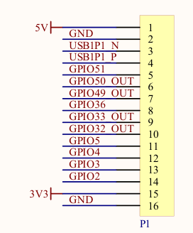
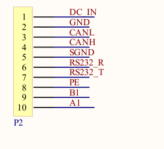
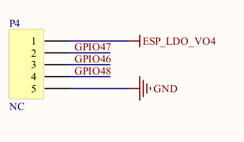
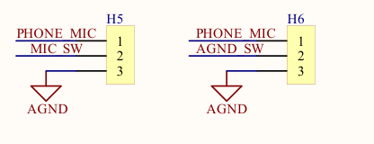
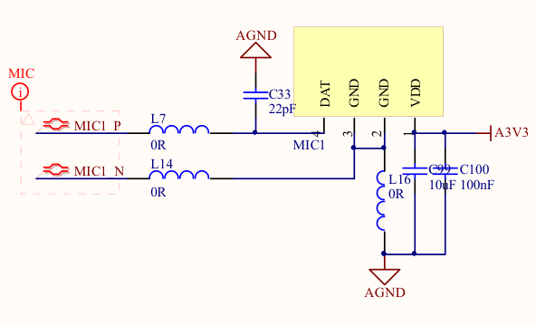
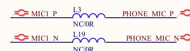
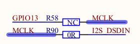

# ESP32-P4-WIFI6-DB-Touch-LCD-10.1 <!-- omit in toc -->

[Simplified Chinese](USER_GUIDE_CN.md)

This user guide will help you get started with ESP32-P4-WIFI6-DB-Touch-LCD-10.1 and will also provide more in-depth information.

ESP32-P4-WIFI6-DB-Touch-LCD-10.1 is a development board built around the ESP32-P4NRW32X processor, paired with an ESP32-C5-MINI-1 wireless coprocessor over SDIO. It integrates a 10.1-inch 800 × 1280 MIPI-DSI capacitive touch display and provides MIPI-CSI, ES8389 audio, PCF85063A RTC, microSD, USB, TWAI/CAN, RS232, RS485, and a GPIO header.

The document consists of the following major sections:

- [Getting Started](#1-getting-started): Overview of the board, its onboard resources, peripherals and factory firmware.
- [Start Application Development](#2-start-application-development): Hardware and software setup before development.
- [Hardware Reference](#3-hardware-reference): GPIO allocation, headers, connectors, jumpers and usage notes.
- [Related Documents](#4-related-documents): Links to related documentation.

# 1. Getting Started

## 1.1. Overview

The ESP32-P4NRW32X main processor handles the display, camera, audio, storage and communication interfaces. The ESP32-C5-MINI-1 acts as a wireless coprocessor and provides Wi-Fi 6 and Bluetooth LE to the ESP32-P4 through ESP-Hosted (SDIO). The ESP32-P4 has no integrated Wi-Fi or Bluetooth, so wireless features require the P4 application and the C5 coprocessor firmware to run together.

## 1.2. Onboard Resources

The table below lists the key components of the board.

<details open>
<summary><b>Onboard resources table</b></summary>

| Key Component | Description |
| --- | --- |
| Main processor | ESP32-P4NRW32X — dual-core high-performance RISC-V system and a low-power core, with integrated PSRAM. |
| Flash | 32 MB external NOR Flash (GD25Q256EYIGR). |
| Wireless coprocessor | ESP32-C5-MINI-1, supporting 2.4 / 5 GHz Wi-Fi 6 and Bluetooth LE, connected to the ESP32-P4 over four-bit SDIO. ESP32-P4 GPIO54 drives the ESP32-C5-MINI-1 EN pin; ESP32-P4 GPIO6 can be used as the wake-up signal for the ESP32-C5-MINI-1. |
| Programming port | CH343P USB-to-UART bridge on UART0 (TX=GPIO37, RX=GPIO38), with automatic download control. |
| USB | USB 2.0 High-Speed port on the ESP32-P4 dedicated USB pins; no GPIOs are used. |
| Display | 10.1-inch 800 × 1280 portrait panel with JD9365 driver and two-lane MIPI-DSI. LCD reset on GPIO31; backlight PWM on GPIO30. |
| Touch | GT911 capacitive touch on the shared GPIO7/GPIO8 I2C bus, with reset on GPIO23 and interrupt on GPIO52. |
| Audio | ES8389 codec, two onboard microphones, two NS4150B speaker amplifiers, and a four-pole 3.5 mm headset jack. Headset insertion disables the speaker amplifiers in hardware. |
| RTC | PCF85063ATL on the shared I2C bus, with interrupt on GPIO20 and backup battery supply. |
| Storage | microSD slot over four-bit SDMMC; card power switched by GPIO45 (active low), IO power from on-chip LDO VO4. |
| Camera | Two-lane MIPI-CSI connector with SCCB on the shared I2C bus; XCLK and RESET are not connected to ESP32-P4 GPIOs. |
| TWAI/CAN | TJA1051T/3/1J transceiver, TX=GPIO22, RX=GPIO21; SW1 selects 120 Ω termination. |
| RS232 | SP3232EEN transceiver, TX=GPIO28, RX=GPIO29, without hardware flow control. |
| RS485 | SP3485EN / SIT3088EESA transceiver, TX=GPIO27, RX=GPIO26, DE/RE=GPIO34; SW1 selects 120 Ω termination. |
| BOOT button | Key2 connects GPIO35 to ground when pressed; Key1 drives ESP_EN for reset. |
| Power indicator | Red PWR1 LED on ESP_3V3, without GPIO control. |
| GPIO headers | P1 is a 16-pin header, P2 a 10-pin communication/power terminal, and P4 a 5-pin expansion connector. GPIO32/33/49/50 pass through a TXB0104 level translator. |
| MIPI PHY power | DSI and CSI share on-chip LDO VO3. |
| 32.768 kHz crystal | Y3 connects to GPIO0/GPIO1 for the ESP32-P4 low-speed clock. |

</details>

## 1.3. Peripheral Quick Reference

<details open>
<summary><b>Peripheral quick reference table</b></summary>

| Module | Device / Function | Interface | Address / Parameters | GPIO / Signal |
| --- | --- | --- | --- | --- |
| LCD | JD9365, 800 × 1280 | MIPI-DSI | 2-lane | RST=GPIO31 |
| LCD backlight | AP3032KTR-G1 | GPIO / PWM | PWM inverted by Q9; BL_EN pulled high | PWM=GPIO30 |
| Touch | GT911 | I2C | 7-bit address 0x5D or 0x14 | SDA=GPIO7, SCL=GPIO8; RST=GPIO23; INT=GPIO52 |
| Camera | MIPI-CSI camera connector | MIPI-CSI + SCCB | 2-lane | SCCB shares GPIO7/8; XCLK/RESET not connected |
| Audio | ES8389 | I2C + I2S | 0x10 | SDA=7, SCL=8; SCLK=12, LRCK=10, DSDIN=9, ASDOUT=11; MCLK disconnected by default |
| Power amp | Speaker amplifier enable | GPIO | Active high | GPIO53 |
| RTC | PCF85063ATL | I2C | 0x51 | SDA=GPIO7, SCL=GPIO8; INT=GPIO20 |
| microSD | microSD slot | SDMMC 4-bit | IO power from LDO VO4 | CLK=43, CMD=44, D0–D3=39–42; power enable=45, active low |
| Wi-Fi/BT coprocessor | ESP32-C5-MINI-1 | SDIO 4-bit | — | CLK=18, CMD=19, D0–D3=14–17; EN=54; wake-up=6 |
| USB | USB 2.0 High-Speed | USB | Internal USB 2.0 HS PHY | Dedicated USB pins |
| TWAI/CAN | CAN transceiver | TWAI | — | TX=GPIO22, RX=GPIO21 |
| RS232 | SP3232EEN | UART | No flow control | TX=GPIO28, RX=GPIO29 |
| RS485 | SP3485EN / SIT3088EESA | UART | Half duplex | TX=GPIO27, RX=GPIO26, DE/RE=GPIO34 |
| BOOT button | Key2 | GPIO | Low when pressed | GPIO35 |
| Power indicator | PWR1 | Power | Red | ESP_3V3 |
| UART0 | Programming and serial logs | UART | Onboard USB-to-UART bridge | TX=GPIO37, RX=GPIO38 |

</details>

## 1.4. Factory Firmware

The ESP-Brookesia application includes drawing, spectrum, music, camera, settings, UART, CAN, and GPIO tools. For features, usage, and build instructions, see the [firmware README](../../firmware/brookesia/README.md).

# 2. Start Application Development

This section describes the hardware you need and the hardware and software setup before development.

## 2.1. Required Hardware

- 1 x ESP32-P4-WIFI6-DB-Touch-LCD-10.1
- 1 x USB Type-C cable for power, firmware download and serial logs
- 1 x Computer running Windows, Linux or macOS

## 2.2. Optional Hardware

- 1 x microSD card
- 1 x MIPI-CSI camera module
- 1 x Speaker
- 1 x USB TO RS232/485 converter for testing RS232 / RS485 from a computer
- 1 x USB-CAN-A analyzer for testing CAN from a computer

## 2.3. Power Supply Options

The board supports the following power options:

- Power through the USB Type-C port.
- External DC supply: DC_IN on P2-1 and GND on P2-2; the circuit is marked for a 5–36 V input.

> **Note**
>
> Check polarity before connecting the external supply.

## 2.4. Hardware Setup

1. Connect the USB-to-UART port to the computer with a USB data cable.
2. Connect the display, camera, and other peripherals with power off and verify cable orientation.
3. Set SW1 termination for CAN or RS485 according to the board position on the bus.
4. If automatic download fails, hold BOOT (Key2), press and release RESET (Key1), then release BOOT.

## 2.5. Software Setup

1. Install ESP-IDF. The local BSP requires ESP-IDF >= 5.5.
2. Build and flash the board check example [board_check](../../examples/esp_idf/board_check/):

   ```bash
   cd examples/esp_idf/board_check
   idf.py set-target esp32p4
   idf.py build
   idf.py -p PORT flash monitor
   ```

   Replace `PORT` with the actual serial port, for example `COM7` on Windows or `/dev/ttyACM0` on Linux.

3. Once the board check passes, continue with the [ESP-IDF examples](../../examples/esp_idf/) or [Arduino examples](../../examples/Arduino/).

# 3. Hardware Reference

This section provides more detailed information about the board hardware.

## 3.1. GPIO Allocation

The table lists every GPIO (0–54) and its board connection.

<details open>
<summary><b>GPIO allocation table (GPIO0–GPIO54)</b></summary>

| GPIO | Signal | Connected To | Notes |
| --- | --- | --- | --- |
| GPIO0 | XTAL_32K_N | 32.768 kHz crystal Y3 |  |
| GPIO1 | XTAL_32K_P | 32.768 kHz crystal Y3 |  |
| GPIO2 | GPIO2 | P1-14 | General-purpose GPIO |
| GPIO3 | GPIO3 | P1-13 | General-purpose GPIO |
| GPIO4 | GPIO4 | P1-12 | General-purpose GPIO |
| GPIO5 | GPIO5 | P1-11 | General-purpose GPIO |
| GPIO6 | C5_WAKEUP | ESP32-C5-MINI-1 | ESP32-P4 GPIO6 can be used as the wake-up signal for the ESP32-C5-MINI-1 |
| GPIO7 | I2C SDA | ES8389, GT911, PCF85063A, camera SCCB | Shared I2C bus |
| GPIO8 | I2C SCL | ES8389, GT911, PCF85063A, camera SCCB | Shared I2C bus |
| GPIO9 | I2S DOUT | ES8389 DSDIN | Playback data, ESP32-P4 → codec |
| GPIO10 | I2S WS | ES8389 LRCK | Audio frame sync |
| GPIO11 | I2S DIN | ES8389 ASDOUT | Capture data, codec → ESP32-P4 |
| GPIO12 | I2S SCLK | ES8389 SCLK | Audio bit clock |
| GPIO13 | I2S MCLK | ES8389 MCLK | R58 unpopulated by default; GPIO13 disconnected from codec |
| GPIO14 | SDIO D0 | ESP32-C5-MINI-1 | SDIO data line |
| GPIO15 | SDIO D1 | ESP32-C5-MINI-1 | SDIO data line |
| GPIO16 | SDIO D2 | ESP32-C5-MINI-1 | SDIO data line |
| GPIO17 | SDIO D3 | ESP32-C5-MINI-1 | SDIO data line |
| GPIO18 | SDIO CLK | ESP32-C5-MINI-1 | SDIO clock |
| GPIO19 | SDIO CMD | ESP32-C5-MINI-1 | SDIO command |
| GPIO20 | RTC_INT | PCF85063ATL INT | RTC interrupt |
| GPIO21 | CAN RX | CAN transceiver | Transceiver → ESP32-P4 |
| GPIO22 | CAN TX | CAN transceiver | ESP32-P4 → transceiver |
| GPIO23 | TP_RST | GT911 reset | Touch controller reset |
| GPIO24 | USB1P1_N | P1-3 | USB Full-Speed D− |
| GPIO25 | USB1P1_P | P1-4 | USB Full-Speed D+ |
| GPIO26 | RS485 RX | RS485 transceiver RO | Transceiver → ESP32-P4 |
| GPIO27 | RS485 TX | RS485 transceiver DI | ESP32-P4 → transceiver |
| GPIO28 | RS232 TX | SP3232EEN DIN1 |  |
| GPIO29 | RS232 RX | SP3232EEN ROUT1 |  |
| GPIO30 | LCD_BL_PWM | AP3032 / Q9 | PWM inverted by Q9 |
| GPIO31 | LCD_RST | JD9365 reset | LCD reset |
| GPIO32 | GPIO32_OUT | P1-10 | Through TXB0104; H8 selects header-side supply |
| GPIO33 | GPIO33_OUT | P1-9 | Through TXB0104; H8 selects header-side supply |
| GPIO34 | RS485 DE/RE | RS485 transceiver | Direction control |
| GPIO35 | BOOT | Key2 | Low when pressed |
| GPIO36 | GPIO36 | P1-8 | Pulled up to 3.3 V |
| GPIO37 | UART0 TX | USB-to-UART bridge | Firmware download and serial logs |
| GPIO38 | UART0 RX | USB-to-UART bridge | Firmware download and serial logs |
| GPIO39 | SD D0 | microSD card | SDMMC data line |
| GPIO40 | SD D1 | microSD card | SDMMC data line |
| GPIO41 | SD D2 | microSD card | SDMMC data line |
| GPIO42 | SD D3 | microSD card | SDMMC data line |
| GPIO43 | SD CLK | microSD card | SDMMC clock |
| GPIO44 | SD CMD | microSD card | SDMMC command |
| GPIO45 | SD_VDD_EN | microSD power switch | Active low |
| GPIO46 | GPIO46 | P4-3 | General-purpose GPIO |
| GPIO47 | GPIO47 | P4-2 | General-purpose GPIO |
| GPIO48 | GPIO48 | P4-4 | General-purpose GPIO |
| GPIO49 | GPIO49_OUT | P1-7 | Through TXB0104; H8 selects header-side supply |
| GPIO50 | GPIO50_OUT | P1-6 | Through TXB0104; H8 selects header-side supply |
| GPIO51 | GPIO51 | P1-5 | General-purpose GPIO |
| GPIO52 | TP_INT | GT911 INT | Touch interrupt |
| GPIO53 | PA_CTRL | Speaker amplifier | Active high |
| GPIO54 | C5_EN | ESP32-C5-MINI-1 EN | High enables; low resets |

</details>

## 3.2. GPIO Header

P1 exposes power, USB Full-Speed signals, and GPIOs. P2 carries external power, CAN, RS232, and RS485. P4 exposes LDO VO4 and GPIO46/47/48; its connector is marked unpopulated.

<details open>
<summary><b>P1 Header (16 Pins)</b></summary>

<table>
  <tr>
    <td valign="middle"></td>
    <td valign="middle">
      <table>
        <tr><th>Pin</th><th>Signal</th><th>Type</th><th>Description</th></tr>
        <tr><td align="center">1</td><td>5V</td><td>Power</td><td></td></tr>
        <tr><td align="center">2</td><td>GND</td><td>Power</td><td>Ground</td></tr>
        <tr><td align="center">3</td><td>USB1P1_N</td><td>USB</td><td>D−</td></tr>
        <tr><td align="center">4</td><td>USB1P1_P</td><td>USB</td><td>D+</td></tr>
        <tr><td align="center">5</td><td>GPIO51</td><td>GPIO</td><td>General-purpose GPIO</td></tr>
        <tr><td align="center">6</td><td>GPIO50_OUT</td><td>GPIO</td><td>TXB0104 level translation</td></tr>
        <tr><td align="center">7</td><td>GPIO49_OUT</td><td>GPIO</td><td>TXB0104 level translation</td></tr>
        <tr><td align="center">8</td><td>GPIO36</td><td>GPIO</td><td>General-purpose GPIO</td></tr>
        <tr><td align="center">9</td><td>GPIO33_OUT</td><td>GPIO</td><td>TXB0104 level translation</td></tr>
        <tr><td align="center">10</td><td>GPIO32_OUT</td><td>GPIO</td><td>TXB0104 level translation</td></tr>
        <tr><td align="center">11</td><td>GPIO5</td><td>GPIO</td><td>General-purpose GPIO</td></tr>
        <tr><td align="center">12</td><td>GPIO4</td><td>GPIO</td><td>General-purpose GPIO</td></tr>
        <tr><td align="center">13</td><td>GPIO3</td><td>GPIO</td><td>General-purpose GPIO</td></tr>
        <tr><td align="center">14</td><td>GPIO2</td><td>GPIO</td><td>General-purpose GPIO</td></tr>
        <tr><td align="center">15</td><td>3V3</td><td>Power</td><td></td></tr>
        <tr><td align="center">16</td><td>GND</td><td>Power</td><td>Ground</td></tr>
      </table>
    </td>
  </tr>
</table>

</details>

<details open>
<summary><b>P2 Terminal (10 Pins)</b></summary>

<table>
  <tr>
    <td valign="middle"></td>
    <td valign="middle">
      <table>
        <tr><th>Pin</th><th>Signal</th><th>Type</th><th>Description</th></tr>
        <tr><td align="center">1</td><td>DC_IN</td><td>Power</td><td>External DC positive</td></tr>
        <tr><td align="center">2</td><td>GND</td><td>Power</td><td>Ground</td></tr>
        <tr><td align="center">3</td><td>CANL</td><td>CAN</td><td>CAN low</td></tr>
        <tr><td align="center">4</td><td>CANH</td><td>CAN</td><td>CAN high</td></tr>
        <tr><td align="center">5</td><td>SGND</td><td>Power</td><td>Signal ground</td></tr>
        <tr><td align="center">6</td><td>RS232_R</td><td>RS232</td><td>Receive</td></tr>
        <tr><td align="center">7</td><td>RS232_T</td><td>RS232</td><td>Transmit</td></tr>
        <tr><td align="center">8</td><td>PE</td><td>Power</td><td>Protective earth</td></tr>
        <tr><td align="center">9</td><td>B1</td><td>RS485</td><td>B</td></tr>
        <tr><td align="center">10</td><td>A1</td><td>RS485</td><td>A</td></tr>
      </table>
    </td>
  </tr>
</table>

</details>

<details open>
<summary><b>P4 Expansion Connector (5 Pins)</b></summary>

<table>
  <tr>
    <td valign="middle"></td>
    <td valign="middle">
      <table>
        <tr><th>Pin</th><th>Signal</th><th>Type</th><th>Description</th></tr>
        <tr><td align="center">1</td><td>ESP_LDO_VO4</td><td>Power</td><td>On-chip LDO VO4</td></tr>
        <tr><td align="center">2</td><td>GPIO47</td><td>GPIO</td><td>General-purpose GPIO</td></tr>
        <tr><td align="center">3</td><td>GPIO46</td><td>GPIO</td><td>General-purpose GPIO</td></tr>
        <tr><td align="center">4</td><td>GPIO48</td><td>GPIO</td><td>General-purpose GPIO</td></tr>
        <tr><td align="center">5</td><td>GND</td><td>Power</td><td>Ground</td></tr>
      </table>
    </td>
  </tr>
</table>

</details>

## 3.3. Camera and Display Connectors

The camera SCCB interface, GT911 touch controller, ES8389 and PCF85063A share I2C on GPIO7/GPIO8. The LCD backlight is controlled by dedicated GPIOs (PWM GPIO30), not over I2C.

| Connector | Interface | ESP32-P4 signals |
| --- | --- | --- |
| Camera | MIPI-CSI | Two data lanes, clock lane, shared I2C; XCLK/RESET not connected |
| Display | MIPI-DSI | Two data lanes, clock lane, LCD RST=GPIO31, backlight PWM=GPIO30, touch I2C + RST=GPIO23; touch INT=GPIO52 |

## 3.4. Jumpers and Switches

### 3.4.1. Termination Resistor Selection (SW1)

SW1 is a two-position switch controlling the 120 Ω termination resistors for CAN and RS485.

<center>

|  |
|:--:|
| Termination switch SW1 |

</center>

| Position | Switch pins | Bus | When ON |
| --- | --- | --- | --- |
| 1 | 1–4 | CAN | R65 (120 Ω) across CANH and CANL |
| 2 | 2–3 | RS485 | R42 (120 Ω) across A and B |

Enable termination at the two ends of the bus and disable it at intermediate nodes.

### 3.4.2. Headset Standard Selection

H5 and H6 select microphone and ground routing for the four-pole headset jack. Change both together.

<center>

|  |
|:--:|
| Headset selection pads H5 / H6 |

</center>

| Standard | H5 connection | H6 connection | Description |
| --- | --- | --- | --- |
| US (CTIA) | 1–2 | 2–3 | MIC_SW → PHONE_MIC; AGND_SW → AGND |
| CN (OMTP) | 2–3 | 1–2 | MIC_SW → AGND; AGND_SW → PHONE_MIC |

When a headset is inserted, EarPhone_Detect drives Q10 and U15 to force AND_PA_CTRL low, disabling both speaker amplifiers. Without a headset, amplifier enable follows GPIO53. The detection signal is not connected to an ESP32-P4 GPIO.

### 3.4.3. Microphone Input Selection (L7 / L14 / L3 / L19)

MIC1 and MIC2 connect to onboard microphones by default. Component population can switch MIC1 to the headset microphone while MIC2 remains onboard.

<center>

|  |  |
|:--:|:--:|
| MIC1 onboard input | MIC1 headset input |

</center>

| MIC1 source | Populate | Leave unpopulated | Description |
| --- | --- | --- | --- |
| Onboard microphone (default) | L7, L14 | L3, L19 | Both MIC1 and MIC2 are onboard |
| Headset microphone | L3, L19 | L7, L14 | MIC1 uses headset input |

Do not connect both input paths at the same time, to avoid paralleling the onboard and headset microphones.

### 3.4.4. Codec Clock Selection (R58 / R90)

The ES8389 MCLK net connects to GPIO13 through R58 and to I2S_DSDIN (GPIO9) through R90. R58 is unpopulated and R90 is 0 Ω by default, so GPIO13 does not supply MCLK to the codec.

<center>

|  |
|:--:|
| ES8389 clock selection |

</center>

| Configuration | R58 | R90 | Connection |
| --- | --- | --- | --- |
| Default | NC | 0 Ω | MCLK → I2S_DSDIN |
| External MCLK | 0 Ω | NC | GPIO13 → MCLK |

Do not populate R58 and R90 together, as that connects GPIO13 to GPIO9.

## 3.5. Usage Notes

- GPIO7/8 share I2C among ES8389, GT911, RTC, and camera SCCB; avoid address conflicts.
- GPIO0/1 connect to the 32.768 kHz crystal. GPIO24/25 expose USB Full-Speed signals; check peripheral configuration before use.
- GPIO52 is the touch interrupt. Backlight PWM is on GPIO30 and inverted by Q9; BL_EN is pulled high and is not connected to an ESP32-P4 GPIO.
- H8 changes only the TXB0104 header-side voltage; it does not make other GPIOs 5 V interfaces.
- Disconnect power before changing H8, headset routing, or codec clock component population.
- Connect display and camera cables with power off and verify orientation.

# 4. Related Documents

## 4.1. Software Resources

- [BSP README](../../components/waveshare_bsp/README.md) and [API reference](../../components/waveshare_bsp/API.md)
- [Firmware README](../../firmware/brookesia/README.md)
