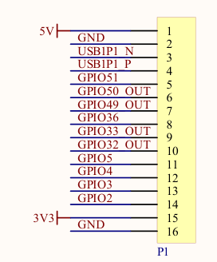
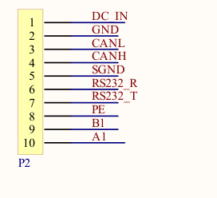
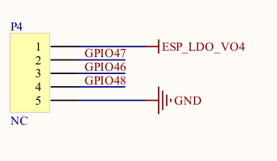
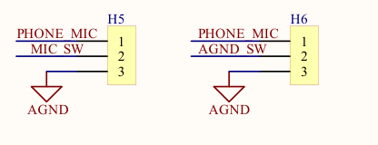
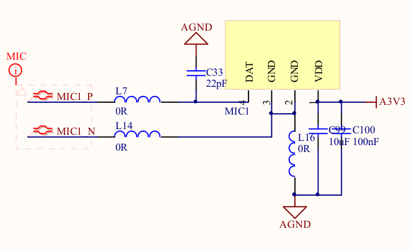
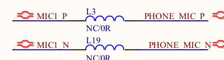
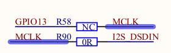

# ESP32-P4-WIFI6-DB-Touch-LCD-10.1 <!-- omit in toc -->

[英文版](USER_GUIDE.md)

本指南将帮助您快速上手 ESP32-P4-WIFI6-DB-Touch-LCD-10.1，并提供该款开发板的详细信息。

ESP32-P4-WIFI6-DB-Touch-LCD-10.1 是一款以 ESP32-P4NRW32X 为主处理器、搭配 ESP32-C5-MINI-1 无线协处理器的开发板，两者通过 SDIO 连接。板载 10.1 英寸 800 × 1280 MIPI-DSI 电容触摸屏，并提供 MIPI-CSI、ES8389 音频、PCF85063A 实时时钟、microSD、USB、TWAI/CAN、RS232、RS485 和 GPIO 排针。

本指南包括如下内容：

- [入门指南](#1-入门指南)：介绍开发板的概况、板载资源、外设和出厂固件。
- [开始开发应用](#2-开始开发应用)：说明开发前需要的硬件和软件设置。
- [硬件参考](#3-硬件参考)：详细介绍 GPIO 分配、排针、接口、跳线和使用注意事项。
- [相关文档](#4-相关文档)：列出相关文档的链接。

# 1. 入门指南

## 1.1. 概述

ESP32-P4NRW32X 主处理器负责显示、摄像头、音频、存储和各类通信接口；ESP32-C5-MINI-1 作为无线协处理器，通过 ESP-Hosted（SDIO）为 ESP32-P4 提供 Wi-Fi 6 和 Bluetooth LE。ESP32-P4 本身不集成 Wi-Fi 或蓝牙，无线功能需要 P4 应用与 C5 协处理器固件配合运行。

## 1.2. 板载资源

下表列出开发板上的主要组件。

<details open>
<summary><b>板载资源表</b></summary>

| 主要组件 | 介绍 |
| --- | --- |
| 主处理器 | ESP32-P4NRW32X，双核高性能 RISC-V 系统与单核低功耗系统，集成 PSRAM。 |
| Flash | 32 MB 外置 NOR Flash（GD25Q256EYIGR）。 |
| 无线协处理器 | ESP32-C5-MINI-1，支持 2.4 / 5 GHz Wi-Fi 6 和 Bluetooth LE，通过四位 SDIO 与 ESP32-P4 相连；ESP32-C5-MINI-1 的 EN 由 ESP32-P4 GPIO54 控制，ESP32-P4 GPIO6 可用作 ESP32-C5-MINI-1 的唤醒信号。 |
| 下载接口 | CH343P USB 转串口，连接 UART0（TX=GPIO37、RX=GPIO38），支持自动下载。 |
| USB | USB 2.0 高速接口，使用 ESP32-P4 专用 USB 引脚，不占用 GPIO。 |
| 显示 | 10.1 英寸 800 × 1280 竖屏，JD9365 驱动，双通道 MIPI-DSI。LCD 复位接 GPIO31，背光 PWM 接 GPIO30。 |
| 触摸 | GT911 电容触摸，挂在 GPIO7/GPIO8 共享 I2C 总线上，复位接 GPIO23，中断接 GPIO52。 |
| 音频 | ES8389 编解码器、两路板载麦克风、双路 NS4150B 扬声器功放和四段 3.5 mm 耳机接口。插入耳机会通过硬件关闭扬声器功放。 |
| 实时时钟 | PCF85063ATL，共享 I2C 总线，中断输出接 GPIO20，支持备用电池供电。 |
| 存储 | microSD 卡座，四位 SDMMC 连接；卡电源由 GPIO45 控制（低电平使能），IO 电源来自片上 LDO VO4。 |
| 摄像头 | 双通道 MIPI-CSI 接口，SCCB 挂在共享 I2C 总线上；XCLK 和 RESET 未连接 ESP32-P4 GPIO。 |
| TWAI/CAN | TJA1051T/3/1J 收发器，TX=GPIO22，RX=GPIO21；SW1 可接入 120 Ω 终端电阻。 |
| RS232 | SP3232EEN 收发器，TX=GPIO28，RX=GPIO29，无硬件流控。 |
| RS485 | SP3485EN / SIT3088EESA 收发器，TX=GPIO27，RX=GPIO26，DE/RE=GPIO34；SW1 可接入 120 Ω 终端电阻。 |
| BOOT 按键 | Key2 接 GPIO35，按下为低电平；Key1 接 ESP_EN，用于复位。 |
| 电源指示灯 | PWR1 红色 LED，接 ESP_3V3，不由 GPIO 控制。 |
| GPIO 排针 | P1 为 16 Pin 排针，P2 为 10 Pin 通信与电源端子，P4 为 5 Pin 扩展接口。GPIO32/33/49/50 经 TXB0104 电平转换后引出。 |
| MIPI PHY 电源 | DSI 与 CSI 共用片上 LDO VO3。 |
| 32.768 kHz 晶振 | Y3 接 GPIO0/GPIO1，为 ESP32-P4 提供低速时钟。 |

</details>

## 1.3. 外设速查

<details open>
<summary><b>外设速查表</b></summary>

| 模块 | 器件 / 功能 | 接口 | 地址 / 参数 | GPIO / 信号 |
| --- | --- | --- | --- | --- |
| LCD | JD9365，800 × 1280 | MIPI-DSI | 双通道 | RST=GPIO31 |
| LCD 背光 | AP3032KTR-G1 | GPIO / PWM | PWM 经 Q9 反相；BL_EN 上拉 | PWM=GPIO30 |
| 触摸 | GT911 | I2C | 7 位地址 0x5D 或 0x14 | SDA=GPIO7, SCL=GPIO8; RST=GPIO23; INT=GPIO52 |
| 摄像头 | MIPI-CSI 摄像头接口 | MIPI-CSI + SCCB | 双通道 | SCCB 共用 GPIO7/8；XCLK/RESET 未连接 |
| 音频 | ES8389 | I2C + I2S | 0x10 | SDA=7，SCL=8；SCLK=12，LRCK=10，DSDIN=9，ASDOUT=11；默认不接 MCLK |
| 功放 | 扬声器功放使能 | GPIO | 高电平有效 | GPIO53 |
| RTC | PCF85063ATL | I2C | 0x51 | SDA=GPIO7, SCL=GPIO8; INT=GPIO20 |
| microSD | microSD 卡座 | SDMMC 4 位 | IO 电源来自 LDO VO4 | CLK=43，CMD=44，D0–D3=39–42；电源使能=45，低电平有效 |
| Wi-Fi/BT 协处理器 | ESP32-C5-MINI-1 | SDIO 4 位 | — | CLK=18，CMD=19，D0–D3=14–17；EN=54；唤醒=6 |
| USB | USB 2.0 高速 | USB | 片内 USB 2.0 高速 PHY | 专用 USB 引脚 |
| TWAI/CAN | CAN 收发器 | TWAI | — | TX=GPIO22，RX=GPIO21 |
| RS232 | SP3232EEN | UART | 无流控 | TX=GPIO28, RX=GPIO29 |
| RS485 | SP3485EN / SIT3088EESA | UART | 半双工 | TX=GPIO27, RX=GPIO26, DE/RE=GPIO34 |
| BOOT 按键 | Key2 | GPIO | 按下为低电平 | GPIO35 |
| 电源指示灯 | PWR1 | 电源 | 红色 | ESP_3V3 |
| UART0 | 下载与串口日志 | UART | 板载 USB 转串口 | TX=GPIO37，RX=GPIO38 |

</details>

## 1.4. 出厂固件

ESP-Brookesia 综合应用集成绘图、频谱、音乐、摄像头、设置、UART、CAN 和 GPIO 工具。功能介绍、使用方法和编译说明请参阅[固件 README](../../firmware/brookesia/README_CN.md)。

# 2. 开始开发应用

本小节介绍开始开发前需要准备的硬件，以及硬件和软件设置。

## 2.1. 必备硬件

- 1 块 ESP32-P4-WIFI6-DB-Touch-LCD-10.1 开发板
- 1 根 USB Type-C 数据线，用于供电、下载固件和查看串口日志
- 1 台电脑（Windows、Linux 或 macOS）

## 2.2. 可选硬件

- 1 张 microSD 卡
- 1 个 MIPI-CSI 摄像头模组
- 1 个扬声器
- 1 个 USB TO RS232/485 转换器，用于在电脑上调试 RS232 / RS485
- 1 个 USB-CAN-A 分析仪，用于在电脑上调试 CAN

## 2.3. 电源选项

开发板支持以下供电方式：

- USB Type-C 接口供电。
- 外部直流电源供电：DC_IN 接 P2-1，GND 接 P2-2，电路标注输入范围为 5–36 V。

> **注意**
>
> 外部电源接入前请确认正负极。

## 2.4. 硬件设置

1. 使用 USB 数据线连接开发板的 USB 转串口接口与电脑。
2. 在断电状态下连接显示屏、摄像头和其他外设，并确认排线方向。
3. 如需使用 CAN 或 RS485，请根据总线位置设置 SW1 终端电阻。
4. 如果自动下载失败，可按住 BOOT（Key2），按下并释放 RESET（Key1），再释放 BOOT。

## 2.5. 软件设置

1. 安装 ESP-IDF。本地 BSP 要求 ESP-IDF >= 5.5。
2. 编译并烧录开发板检查示例 [board_check](../../examples/esp_idf/board_check/)：

   ```bash
   cd examples/esp_idf/board_check
   idf.py set-target esp32p4
   idf.py build
   idf.py -p PORT flash monitor
   ```

   将 `PORT` 替换为实际串口号，例如 Windows 上的 `COM7` 或 Linux 上的 `/dev/ttyACM0`。

3. 开发板检查通过后，可继续运行 [ESP-IDF 示例](../../examples/esp_idf/) 或 [Arduino 示例](../../examples/Arduino/)。

# 3. 硬件参考

本小节介绍有关开发板硬件的更多信息。

## 3.1. GPIO 分配

下表列出全部 GPIO（0–54）及其板上连接。

<details open>
<summary><b>GPIO 分配表（GPIO0–GPIO54）</b></summary>

| GPIO | 信号 | 连接对象 | 说明 |
| --- | --- | --- | --- |
| GPIO0 | XTAL_32K_N | 32.768 kHz 晶振 Y3 |  |
| GPIO1 | XTAL_32K_P | 32.768 kHz 晶振 Y3 |  |
| GPIO2 | GPIO2 | P1-14 | 通用 GPIO |
| GPIO3 | GPIO3 | P1-13 | 通用 GPIO |
| GPIO4 | GPIO4 | P1-12 | 通用 GPIO |
| GPIO5 | GPIO5 | P1-11 | 通用 GPIO |
| GPIO6 | C5_WAKEUP | ESP32-C5-MINI-1 | ESP32-P4 GPIO6 可用作 ESP32-C5-MINI-1 的唤醒信号 |
| GPIO7 | I2C SDA | ES8389、GT911、PCF85063A、摄像头 SCCB | 共享 I2C 总线 |
| GPIO8 | I2C SCL | ES8389、GT911、PCF85063A、摄像头 SCCB | 共享 I2C 总线 |
| GPIO9 | I2S DOUT | ES8389 DSDIN | 播放数据，ESP32-P4 → 编解码器 |
| GPIO10 | I2S WS | ES8389 LRCK | 音频帧同步 |
| GPIO11 | I2S DIN | ES8389 ASDOUT | 录音数据，编解码器 → ESP32-P4 |
| GPIO12 | I2S SCLK | ES8389 SCLK | 音频位时钟 |
| GPIO13 | I2S MCLK | ES8389 MCLK | R58 默认不焊，GPIO13 不接编解码器 |
| GPIO14 | SDIO D0 | ESP32-C5-MINI-1 | SDIO 数据线 |
| GPIO15 | SDIO D1 | ESP32-C5-MINI-1 | SDIO 数据线 |
| GPIO16 | SDIO D2 | ESP32-C5-MINI-1 | SDIO 数据线 |
| GPIO17 | SDIO D3 | ESP32-C5-MINI-1 | SDIO 数据线 |
| GPIO18 | SDIO CLK | ESP32-C5-MINI-1 | SDIO 时钟 |
| GPIO19 | SDIO CMD | ESP32-C5-MINI-1 | SDIO 命令 |
| GPIO20 | RTC_INT | PCF85063ATL INT | RTC 中断 |
| GPIO21 | CAN RX | CAN 收发器 | 收发器 → ESP32-P4 |
| GPIO22 | CAN TX | CAN 收发器 | ESP32-P4 → 收发器 |
| GPIO23 | TP_RST | GT911 复位 | 触摸控制器复位 |
| GPIO24 | USB1P1_N | P1-3 | USB 全速 D− |
| GPIO25 | USB1P1_P | P1-4 | USB 全速 D+ |
| GPIO26 | RS485 RX | RS485 收发器 RO | 收发器 → ESP32-P4 |
| GPIO27 | RS485 TX | RS485 收发器 DI | ESP32-P4 → 收发器 |
| GPIO28 | RS232 TX | SP3232EEN DIN1 |  |
| GPIO29 | RS232 RX | SP3232EEN ROUT1 |  |
| GPIO30 | LCD_BL_PWM | AP3032 / Q9 | PWM 经 Q9 反相 |
| GPIO31 | LCD_RST | JD9365 复位 | LCD 复位 |
| GPIO32 | GPIO32_OUT | P1-10 | 经 TXB0104 电平转换；H8 选择输出侧电源 |
| GPIO33 | GPIO33_OUT | P1-9 | 经 TXB0104 电平转换；H8 选择输出侧电源 |
| GPIO34 | RS485 DE/RE | RS485 收发器 | 收发方向控制 |
| GPIO35 | BOOT | Key2 | 按下为低电平 |
| GPIO36 | GPIO36 | P1-8 | 默认上拉至 3.3 V |
| GPIO37 | UART0 TX | USB 转串口 | 固件下载与串口日志 |
| GPIO38 | UART0 RX | USB 转串口 | 固件下载与串口日志 |
| GPIO39 | SD D0 | microSD 卡 | SDMMC 数据线 |
| GPIO40 | SD D1 | microSD 卡 | SDMMC 数据线 |
| GPIO41 | SD D2 | microSD 卡 | SDMMC 数据线 |
| GPIO42 | SD D3 | microSD 卡 | SDMMC 数据线 |
| GPIO43 | SD CLK | microSD 卡 | SDMMC 时钟 |
| GPIO44 | SD CMD | microSD 卡 | SDMMC 命令 |
| GPIO45 | SD_VDD_EN | microSD 电源开关 | 低电平使能 |
| GPIO46 | GPIO46 | P4-3 | 通用 GPIO |
| GPIO47 | GPIO47 | P4-2 | 通用 GPIO |
| GPIO48 | GPIO48 | P4-4 | 通用 GPIO |
| GPIO49 | GPIO49_OUT | P1-7 | 经 TXB0104 电平转换；H8 选择输出侧电源 |
| GPIO50 | GPIO50_OUT | P1-6 | 经 TXB0104 电平转换；H8 选择输出侧电源 |
| GPIO51 | GPIO51 | P1-5 | 通用 GPIO |
| GPIO52 | TP_INT | GT911 INT | 触摸中断 |
| GPIO53 | PA_CTRL | 扬声器功放 | 高电平使能 |
| GPIO54 | C5_EN | ESP32-C5-MINI-1 EN | 高电平使能，低电平复位 |

</details>

## 3.2. GPIO 排针

P1 引出电源、USB 全速信号和 GPIO；P2 引出外部电源、CAN、RS232 和 RS485；P4 引出 LDO VO4 和 GPIO46/47/48，连接器标为不贴装。

<details open>
<summary><b>P1 排针（16 Pin）</b></summary>

<table>
  <tr>
    <td valign="middle"></td>
    <td valign="middle">
      <table>
        <tr><th>引脚</th><th>信号</th><th>类型</th><th>说明</th></tr>
        <tr><td align="center">1</td><td>5V</td><td>电源</td><td></td></tr>
        <tr><td align="center">2</td><td>GND</td><td>电源</td><td>地</td></tr>
        <tr><td align="center">3</td><td>USB1P1_N</td><td>USB</td><td>D−</td></tr>
        <tr><td align="center">4</td><td>USB1P1_P</td><td>USB</td><td>D+</td></tr>
        <tr><td align="center">5</td><td>GPIO51</td><td>GPIO</td><td>通用 GPIO</td></tr>
        <tr><td align="center">6</td><td>GPIO50_OUT</td><td>GPIO</td><td>TXB0104 电平转换</td></tr>
        <tr><td align="center">7</td><td>GPIO49_OUT</td><td>GPIO</td><td>TXB0104 电平转换</td></tr>
        <tr><td align="center">8</td><td>GPIO36</td><td>GPIO</td><td>通用 GPIO</td></tr>
        <tr><td align="center">9</td><td>GPIO33_OUT</td><td>GPIO</td><td>TXB0104 电平转换</td></tr>
        <tr><td align="center">10</td><td>GPIO32_OUT</td><td>GPIO</td><td>TXB0104 电平转换</td></tr>
        <tr><td align="center">11</td><td>GPIO5</td><td>GPIO</td><td>通用 GPIO</td></tr>
        <tr><td align="center">12</td><td>GPIO4</td><td>GPIO</td><td>通用 GPIO</td></tr>
        <tr><td align="center">13</td><td>GPIO3</td><td>GPIO</td><td>通用 GPIO</td></tr>
        <tr><td align="center">14</td><td>GPIO2</td><td>GPIO</td><td>通用 GPIO</td></tr>
        <tr><td align="center">15</td><td>3V3</td><td>电源</td><td></td></tr>
        <tr><td align="center">16</td><td>GND</td><td>电源</td><td>地</td></tr>
      </table>
    </td>
  </tr>
</table>

</details>

<details open>
<summary><b>P2 端子（10 Pin）</b></summary>

<table>
  <tr>
    <td valign="middle"></td>
    <td valign="middle">
      <table>
        <tr><th>引脚</th><th>信号</th><th>类型</th><th>说明</th></tr>
        <tr><td align="center">1</td><td>DC_IN</td><td>电源</td><td>外部直流电源正极</td></tr>
        <tr><td align="center">2</td><td>GND</td><td>电源</td><td>地</td></tr>
        <tr><td align="center">3</td><td>CANL</td><td>CAN</td><td>CAN 低</td></tr>
        <tr><td align="center">4</td><td>CANH</td><td>CAN</td><td>CAN 高</td></tr>
        <tr><td align="center">5</td><td>SGND</td><td>电源</td><td>信号地</td></tr>
        <tr><td align="center">6</td><td>RS232_R</td><td>RS232</td><td>接收</td></tr>
        <tr><td align="center">7</td><td>RS232_T</td><td>RS232</td><td>发送</td></tr>
        <tr><td align="center">8</td><td>PE</td><td>电源</td><td>保护地</td></tr>
        <tr><td align="center">9</td><td>B1</td><td>RS485</td><td>B</td></tr>
        <tr><td align="center">10</td><td>A1</td><td>RS485</td><td>A</td></tr>
      </table>
    </td>
  </tr>
</table>

</details>

<details open>
<summary><b>P4 扩展接口（5 Pin）</b></summary>

<table>
  <tr>
    <td valign="middle"></td>
    <td valign="middle">
      <table>
        <tr><th>引脚</th><th>信号</th><th>类型</th><th>说明</th></tr>
        <tr><td align="center">1</td><td>ESP_LDO_VO4</td><td>电源</td><td>片上 LDO VO4</td></tr>
        <tr><td align="center">2</td><td>GPIO47</td><td>GPIO</td><td>通用 GPIO</td></tr>
        <tr><td align="center">3</td><td>GPIO46</td><td>GPIO</td><td>通用 GPIO</td></tr>
        <tr><td align="center">4</td><td>GPIO48</td><td>GPIO</td><td>通用 GPIO</td></tr>
        <tr><td align="center">5</td><td>GND</td><td>电源</td><td>地</td></tr>
      </table>
    </td>
  </tr>
</table>

</details>

## 3.3. 摄像头与显示接口

摄像头 SCCB、GT911 触摸控制器、ES8389 和 PCF85063A 共用 GPIO7/GPIO8 I2C 总线。LCD 背光由独立 GPIO 控制（PWM GPIO30），不经过 I2C。

| 接口 | 总线 | ESP32-P4 信号 |
| --- | --- | --- |
| 摄像头 | MIPI-CSI | 两条数据通道、时钟通道、共享 I2C；XCLK/RESET 未连接 |
| 显示屏 | MIPI-DSI | 两条数据通道、时钟通道、LCD RST=GPIO31、背光 PWM=GPIO30、触摸 I2C + RST=GPIO23；触摸 INT=GPIO52 |

## 3.4. 跳线与拨码开关

### 3.4.1. 终端电阻选择（SW1）

SW1 为两位拨码开关，分别控制 CAN 和 RS485 的 120 Ω 终端电阻。

<center>

|  |
|:--:|
| 终端电阻开关 SW1 |

</center>

| 拨码位 | 开关引脚 | 总线 | 拨到 ON 时 |
| --- | --- | --- | --- |
| 1 | 1–4 | CAN | R65（120 Ω）接入 CANH 与 CANL |
| 2 | 2–3 | RS485 | R42（120 Ω）接入 A 与 B |

终端电阻接在总线两端。开发板位于总线末端时接入，位于总线中间时断开。

### 3.4.2. 耳机接口标准选择

H5、H6 选择四段耳机接口的麦克风与地线位置。两组连接应配套调整。

<center>

|  |
|:--:|
| 耳机接口选择焊盘 H5 / H6 |

</center>

| 标准 | H5 连接 | H6 连接 | 说明 |
| --- | --- | --- | --- |
| US (CTIA) | 1–2 | 2–3 | MIC_SW → PHONE_MIC; AGND_SW → AGND |
| CN (OMTP) | 2–3 | 1–2 | MIC_SW → AGND; AGND_SW → PHONE_MIC |

插入耳机时，EarPhone_Detect 通过 Q10 和 U15 将 AND_PA_CTRL 拉低，关闭两路扬声器功放；未插入时，功放使能跟随 GPIO53。该检测信号未连接到 ESP32-P4 GPIO。

### 3.4.3. 麦克风输入选择（L7 / L14 / L3 / L19）

MIC1、MIC2 默认接板载麦克风。MIC1 可通过贴装选择切换为耳机麦克风，MIC2 保持板载输入。

<center>

|  |  |
|:--:|:--:|
| MIC1 板载输入 | MIC1 耳机输入 |

</center>

| MIC1 输入源 | 贴装 | 不贴 | 说明 |
| --- | --- | --- | --- |
| 板载麦克风（默认） | L7, L14 | L3, L19 | MIC1、MIC2 均为板载输入 |
| 耳机麦克风 | L3, L19 | L7, L14 | MIC1 接耳机输入 |

两组输入不要同时接通，避免板载麦克风和耳机麦克风并联。

### 3.4.4. 编解码器时钟选择（R58 / R90）

ES8389 的 MCLK 网络通过 R58 连接 GPIO13，通过 R90 连接 I2S_DSDIN（GPIO9）。默认 R58 不焊、R90 为 0 Ω，GPIO13 不向编解码器提供 MCLK。

<center>

|  |
|:--:|
| ES8389 时钟选择 |

</center>

| 配置 | R58 | R90 | 连接 |
| --- | --- | --- | --- |
| 默认 | NC | 0 Ω | MCLK → I2S_DSDIN |
| 外部 MCLK | 0 Ω | NC | GPIO13 → MCLK |

R58 与 R90 不能同时贴装，否则会连接 GPIO13 和 GPIO9。

## 3.5. 使用注意事项

- GPIO7/8 共享 I2C 总线连接 ES8389、GT911、RTC 和摄像头 SCCB，外接器件时避免地址冲突。
- GPIO0/1 连接 32.768 kHz 晶振；GPIO24/25 引出 USB 全速信号，使用前确认对应外设配置。
- GPIO52 用于触摸中断。背光 PWM 接 GPIO30，经 Q9 反相；BL_EN 由电阻上拉，未接 ESP32-P4 GPIO。
- H8 只改变 TXB0104 输出侧电平，不能将其他 GPIO 当作 5 V 接口使用。
- 更改 H8、耳机或音频时钟焊接配置前请断电。
- 请在断电状态下连接显示屏和摄像头排线，并确认排线方向。

# 4. 相关文档

## 4.1. 软件资源

- [BSP README](../../components/waveshare_bsp/README.md) 与 [API 参考](../../components/waveshare_bsp/API.md)
- [固件说明](../../firmware/brookesia/README_CN.md)
